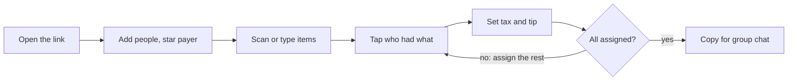

# PRD: Split the Slip v1.0

Nov 26, 2026 · Kaitlin Mae Frani

## Overview

Split the Slip v1.0 is a free web app that turns a restaurant receipt into a per-person "who owes what" message in under a minute, with no app install and no account. It is live at [kaitlinmae.github.io/SplitTheSlip](https://kaitlinmae.github.io/SplitTheSlip/) and as a Claude artifact. This PRD supersedes the earlier [MVP PRD](01%20PRD%20-%20Receipt%20Bill%20Splitter%20(MVP).md) and reflects what was actually built and tested.

**Problem.** Friends eating out together struggle to work out each person's share by what they ordered when one person pays the whole bill, which delays repayment to the person who paid. Today they either calculate it by hand (about 5 minutes) or upload the receipt to an AI chat and type out who ordered what. Both fall short: re-explaining the order to an AI is repetitive, and only people with an AI tool can do it, so the work always lands on one person.

**Goals**

1. A group can go from a photo of the receipt to a pasted group-chat message in under 1 minute, down from the 5-minute manual baseline.
2. Every split adds up to the exact cent of the bill, with no rounding loss for the payer.
3. Anyone can use it from a shared link: free, no sign-up, works on any phone browser.
4. Receipt photos stay private: on the public site they are read on the device and never uploaded.

**Discovery and positioning**

- **Started from a solution, not a problem.** "A receipt bill calculator" could mean bill splitting, expense tracking or expense reports; we chose splitting one dinner check by what each person ordered.
- **Two pains, one first.** Slow maths at the table and slow repayment to the payer point to different products. v1.0 solves the maths; payment links move to v2.
- **Competitors.** The phone calculator is the "do nothing" competitor: free, familiar and on every phone, so the app must be clearly faster. Splitwise exists; our angle is the fastest way to split one dinner check with no sign-up.
- **Requirement from discovery.** "Not everyone has Claude" became: anyone can use it with no account, no download and no AI subscription.
- **Evidence.** So far n=1 (the owner's friend group); 3 to 5 friend interviews are still open.

## Users and use cases

The primary user is the person who paid the bill and needs to collect from friends; everyone else only reads the group-chat message.

| Persona | Situation | What they need |
| --- | --- | --- |
| The payer | Put the whole bill on their card at dinner | Fast, exact amounts per person and a message they can paste |
| The organizer | Splitting while everyone is still at the table | Scan, tap who had what, settle before leaving |
| The friend on the receiving end | Gets a link or a message in the group chat | A clear amount, and a way to check the maths |

**Core use cases**

1. Scan a receipt photo (new or from the library), then tap names under each item.
2. Split shared dishes between some or all of the table.
3. Split tax and tip evenly or in proportion to what each person ordered.
4. Copy a short message for the group chat: "food tab, $105 total paid by Alex: Sam: $30, Jordan: $55".

## Requirements

All P0 and P1 requirements below shipped in v1.0; P2 items are on the roadmap.

| ID | Requirement | Priority | Status |
| --- | --- | --- | --- |
| F1 | Add people and mark who paid (star) | P0 | Shipped |
| F2 | Add, edit and delete items with prices; long names wrap | P0 | Shipped |
| F3 | Tap names under an item to assign it; shared items split evenly between those tapped | P0 | Shipped |
| F4 | Tax and tip, each split Even (default) or Proportional | P0 | Shipped |
| F5 | Tip entered as % or $ | P0 | Shipped |
| F6 | Per-person totals that add up to the exact cent (largest-remainder rounding) | P0 | Shipped |
| F7 | Tap a person to see their full breakdown | P1 | Shipped |
| F8 | Copy a short group-chat message; disabled until every item is assigned | P0 | Shipped |
| F9 | Scan a receipt photo (camera or library) and fill in items, tax and tip | P0 | Shipped |
| F10 | Scanned tip keeps the receipt's form: % sets % mode, $ sets $ mode | P1 | Shipped |
| F11 | Scan while items exist asks: add to them or replace them, with Undo | P1 | Shipped |
| F12 | New bill with 8-second Undo | P1 | Shipped |
| F13 | Bill saved in the browser between visits | P1 | Shipped |
| F14 | One-tap "split everything evenly" and an "Everyone" chip | P2 | Roadmap |
| F15 | Native share sheet and Venmo / Cash App request links | P2 | Roadmap |

**Scope history.** The first prioritization pass (Nov 24) used MoSCoW under a role-play limit of 6 of 10 features. It surfaced a hidden gap: cutting "calculation breakdown" left the app with no output, so the feature was scoped down into per-person totals (core) plus the full breakdown (proof). Shared items, the breakdown and text sharing were later kept because they cost almost nothing to build.

**Deferred to v2 in the original scope:** save results as an image, payment links (Venmo, Cash App), and splitting the whole bill evenly, since a phone calculator already does that in about 10 seconds. Drag to assign was cut in favour of tap to assign.

**Non-functional**

- **Privacy:** no server, no accounts; on the public site photos are read on the device.
- **Platforms:** current iOS and Android browsers, including iOS 17.4 and earlier.
- **Accessibility:** WCAG AA text contrast, selected state not shown by colour alone, keyboard reachable.
- **Reliability:** a damaged saved bill recovers instead of showing a blank page.
- **Quality:** automated tests for the money maths and the receipt parser (26 passing at v1.0).

## User flow and split rules

The copy button stays off until every item is assigned, so nobody is sent a wrong amount.

**Split rules**

- A shared item is divided evenly between the people tapped on it.
- **Even** (default) splits the whole tax and tip equally, straight away, even before items are assigned.
- **Proportional** splits tax and tip by each person's share of assigned items; tax and tip on unassigned items are charged to no one until they're assigned.
- Totals use largest-remainder rounding, so shares always add up to the exact cent (a $6.50 dish three ways is $2.17, $2.17, $2.16).

**Open tension: the tax default.** On Nov 24 the default for tax and tip was set to Proportional after user pushback ("I had a $12 salad and Jake had a $45 steak. Why am I paying the same tax as him?"). On Nov 26 the owner made Even the default, because Proportional showed $0.00 until items were assigned and read as broken. Even is now simpler but overcharges light orderers on tax; a middle option is tax Proportional, tip Even. To decide with tester feedback.

**Receipt scanning**

- Inside Claude, the photo is read by Claude. On the public site, it is read on the device by Tesseract.js.
- The on-device reader first cleans the photo: crops to the paper, evens out shadows, converts to black and white, and turns sideways or tilted receipts upright.
- The parser skips totals, payment and suggested-tip lines, keeps fees like "Restaurant Fee (3.00%)" as items, and checks items against the printed subtotal.
- A scanned tip keeps the receipt's form: a printed % sets % mode, a dollar tip sets $ mode.

## Metrics, scope and risks

The north star is time to split a bill, from 5 minutes by hand to under 1 minute. v1.0 has no analytics yet, so these are measured through friend testing until privacy-friendly counting is added.

| Metric | How measured | Baseline | Target |
| --- | --- | --- | --- |
| Time to split (north star) | Seconds from receipt upload to summary copied or shared | About 5 min by hand | Under 1 minute |
| Scan accuracy | Share of receipt items read correctly with no manual edit | None yet | 90% or more |
| Trust | Share of splits where users don't change the amounts or redo the maths by hand | None yet | 85% or more |
| Retention | Share of users who split another bill within 30 days | None yet | 30% or more |

The 1-minute target must be defensible ("why that number?"); the 5-minute baseline is what makes it meaningful. No sign-up means retention can only be estimated, a tradeoff chosen knowingly. Tester questions map to the metrics: "Were the scanned items right?", "Did the totals look fair?", "Would you use this next time?"

**Out of scope for v1.0**

- Accounts, saved history across devices and payment processing.
- Multiple currencies and non-English receipts.
- Splitting by custom percentages or shares other than even.

**Risks**

| Risk | Impact | Mitigation |
| --- | --- | --- |
| On-device reader misreads blurry, faint or multi-line items ("2 @ 8.50" then "17.00") | Wrong items or prices | Photo clean-up, subtotal check, red warning, every item editable; AI scanning via API is a v2 upgrade |
| Scanning inside Claude only works for people signed in to Claude | Conflicts with "anyone can use it" | Public site reads photos on the device; manual entry always works |
| Receipt photos contain personal data | Privacy concern | On the public site photos never leave the phone |
| Retention can't be measured precisely without accounts | Weak data on return use | Accepted tradeoff; possible anonymous browser ID |
| Public repo means the code is visible | Copying | All-rights-reserved LICENSE and copyright notices |
| Phones keep showing an old cached version | Users miss fixes | Release notes tell testers to use a private tab |
| A plain web wrapper may be rejected from the App Store (Guideline 4.2) | Blocks a later native launch | Add native-only features if going native (built-in text recognition, live camera, Contacts) |
| AI-assisted code may have weaker copyright protection | Harder to enforce | Document human direction and decisions (this folder) |

**Open questions**

- [ ] Validate the problem with 3 to 5 friends outside the owner's group
- [ ] Tax default: Even (current), Proportional (Nov 24 call), or tax Proportional with tip Even?
- [ ] Is 1 minute the right target, and can testers hit it with scanning plus fixes?
- [ ] Is repayment (payment links) the bigger pain? Decide v2 priority from launch data
- [ ] Should the group message carry an optional "Split with Split the Slip" link?
- [ ] Which privacy-friendly analytics tool, if any, fits the "no tracking" promise?
