# Product Roadmap: Split the Slip

Nov 26, 2026 · Kaitlin Mae Frani

With v1.0 shipped, the next phase is about conversion: getting a stranger from the shared link to a sent split in under 30 seconds.

## Roadmap

Conversion basics ship first, then polish, then measurement.

```mermaid
flowchart LR
    subgraph NOW["Now · Tier 1: get people started"]
        direction TB
        n1[Focused first screen]
        n2[Sticky who-owes-what bar]
        n3[Share sheet + app link]
        n4[Everyone chip per item]
        n5[Link preview + app icon]
    end
    subgraph NEXT["Next · Tier 2: feel like a product"]
        direction TB
        x1[One step at a time]
        x2[Scanning screen + result]
        x3[Preload the photo reader]
        x4[Icon and spacing polish]
        x5[Assign by person]
    end
    subgraph LATER["Later · Tier 3: measure and tidy"]
        direction TB
        l1[Privacy-friendly visit counts]
        l2[Venmo / Cash App requests]
        l3[Breakdown cents, screen readers]
        l4["AI scanning upgrade (API)"]
        l5[Native app, if people return]
    end
    NOW -- "Gate 1: Tier 1 tested on a real phone" --> NEXT
    NEXT -- "Gate 2: owner decides on visit counts" --> LATER
```

Now is the current phase. Its five items were prioritized in the [Tier 1 feature brief](Feature%20Briefs/Tier%201%20Conversion.md) and ship together as one release (decision #34) before any Tier 2 work starts.

## Why each initiative

The growth audit found the product is strong but the first screen sells none of it: new visitors land on a stranger's sample dinner and a soft, half-disabled-looking button.

| Initiative | Phase | Problem it fixes |
| --- | --- | --- |
| Focused first screen | Now | Sample dinner confuses new visitors; the main action is buried |
| Sticky "who owes what" bar | Now | The payoff sits in the fourth card, after all the work |
| Share sheet and app link | Now | Copy, switch apps, paste loses people; the app link adds a growth loop |
| "Everyone" chip per item (no whole-bill button, decision #31) | Now | Shared dishes take a tap per name |
| Link preview and home-screen icon | Now | Shared links look bare, so fewer friends tap through |
| One step at a time | Next | Four stacked cards feel like a form |
| Scanning screen with a clear result | Next | A small grey status line doesn't build trust |
| Preload the photo reader | Next | First scan waits on a several-MB download |
| Icon and spacing polish | Next | Mixed symbols and four step colours look AI-made |
| Assign by person | Next | Item-by-item tapping is slow for big groups |
| Tester survey and in-app "Did these totals look right?" prompt | Next | The scan-accuracy, trust and retention targets can't be checked without them |
| Venmo and Cash App requests | Later | The repayment pain; kept in v2 until testers say it's bigger than the maths (decision #32) |
| Privacy-friendly visit counts | Later | No way to measure time to split or retention today |
| Remaining review items (breakdown cents, screen readers) | Later | Low-severity polish from the release review |
| AI scanning upgrade via an API | Later | Only if scan accuracy is the main tester complaint; costs per scan and needs a server |
| Native iPhone app | Later | Only if retention shows people come back; needs native features (built-in text recognition, live camera, Contacts) to pass App Store Guideline 4.2 |
